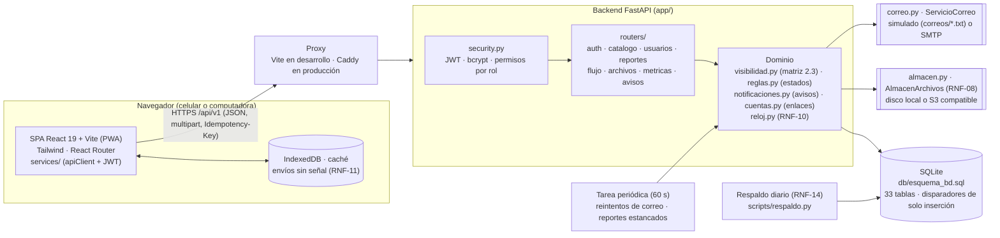
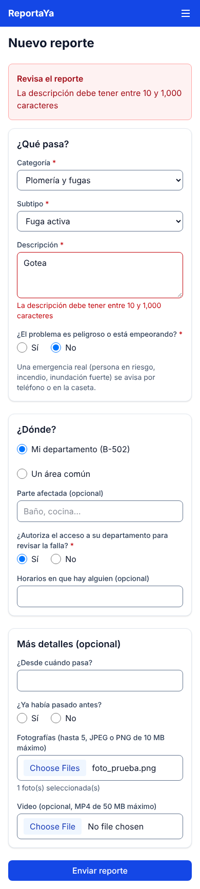
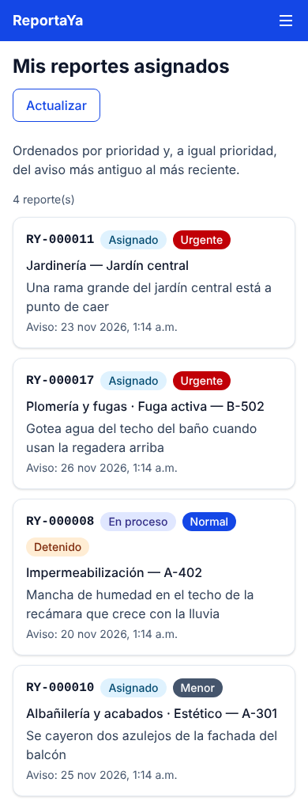
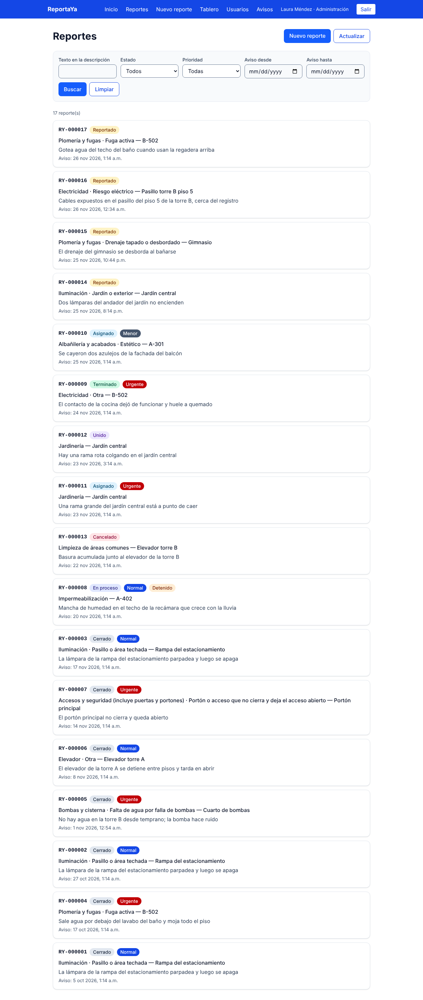
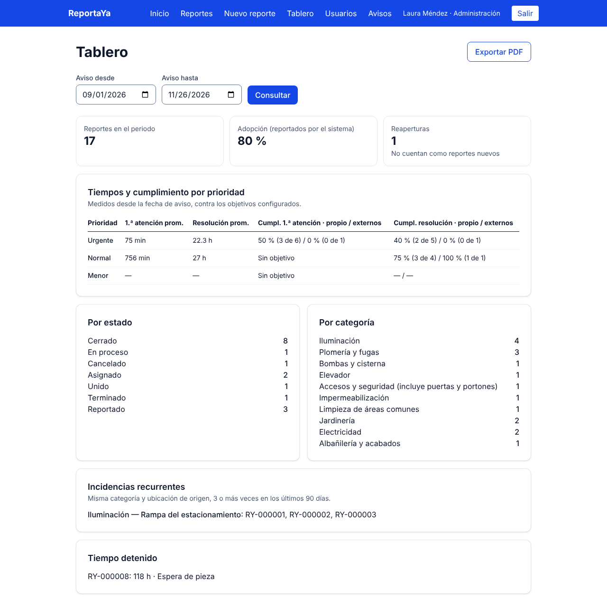
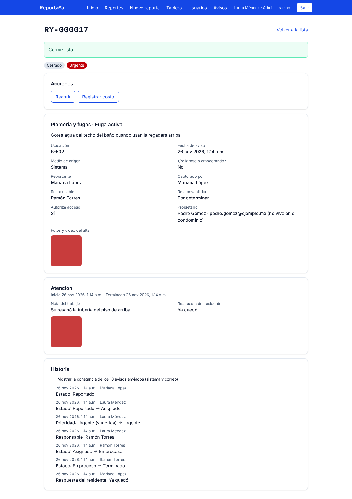
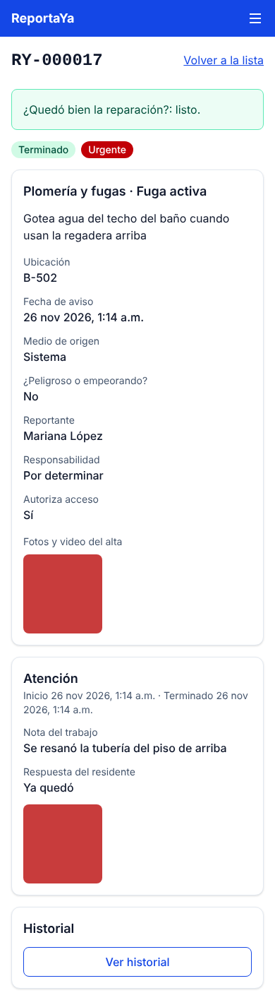
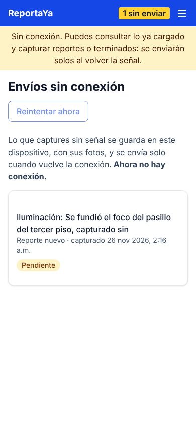
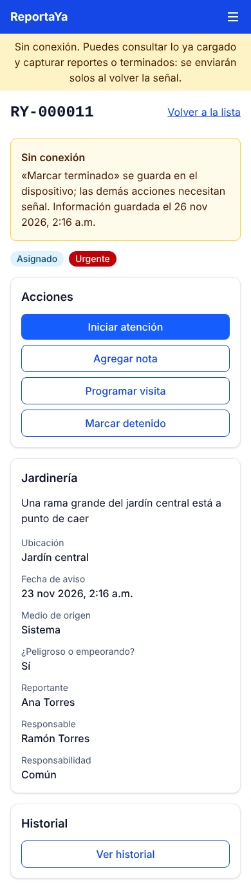

# ReportaYa

**Sistema de reporte y seguimiento de incidencias de mantenimiento para un condominio** · Equipo 5 · TC5062

    

## Qué problema resuelve

En el condominio, las fallas de mantenimiento llegan por WhatsApp, llamadas, la caseta, correo o de palabra, y se anotan en una libreta o una hoja de cálculo. No hay un registro único: los reportes se pierden entre otros mensajes, dos personas reportan lo mismo, nadie sabe en qué estado va cada uno y la Administración no tiene evidencia con fechas para responder a los residentes ni al comité.

**ReportaYa** pone todo en un solo lugar:

- El **residente** reporta desde el celular con fotos y ubicación, y consulta el estado y la visita sin preguntar.
- La **Administración** y **Vigilancia** capturan los avisos que llegan por otros medios, con la fecha real del aviso.
- La **Administración** clasifica, asigna y cierra. **Mantenimiento** (personal propio o proveedor) registra el avance y la evidencia fotográfica.
- El residente confirma si la reparación quedó bien («Ya quedó» / «Sigue fallando»), y nada se cierra sin esa revisión.
- La Administración mide el tiempo de atención contra un objetivo por prioridad, detecta las fallas recurrentes y lleva al comité un PDF con cifras verificables.

Requerimientos: [`S03_A1/SRS_equipo.md`](S03_A1/SRS_equipo.md) (27 RF). Trazabilidad: [`S11_A1/matriz_trazabilidad.md`](S11_A1/matriz_trazabilidad.md) (**27 de 27 RF completos**).

## Arquitectura



- **Una sola colección de reportes, con alcance por rol.** `GET /reports` y `GET /reports/{folio}` devuelven solo lo que la matriz de visibilidad del SRS (2.3) permite a quien pregunta. Un reporte ajeno responde 404, y los campos confidenciales (notas, monto, propietario, responsable) se quitan antes de responder (`app/visibilidad.py`, RNF-05).
- **Las transiciones de estado son subrecursos creados con POST** (`assignments`, `cycles`, `completions`, `resident-responses`, `closures`, `cancellations`, `reopenings`, `merges`). `app/reglas.py` contiene la tabla de transiciones permitidas (patrón State) y cualquier otra responde 409.
- **Los avisos se separan del flujo** (patrón Observer). Cada transición dice qué pasó y `notificaciones.py` decide a quién avisar según la tabla de RF-11. El aviso y el correo pendiente se guardan en la misma transacción que el cambio; el correo sale después y se reintenta 3 veces cada 10 minutos.
- **El reloj se puede fijar** (`app/reloj.py`): las pruebas fijan la hora para verificar los plazos de 72 h, 1 h, 30 días y los tiempos del tablero (RNF-10).
- **El historial es inalterable:** disparadores de solo inserción en la base y `DELETE` → 403 (RNF-07).
- **Funciona con mala señal (RNF-11).** La app es una PWA: el service worker guarda la interfaz, las consultas ya hechas quedan en caché y un reporte o un terminado capturado sin señal se guarda con sus fotos en IndexedDB. Se envía solo al volver la conexión con un `Idempotency-Key`, así que un reintento nunca duplica el reporte. El usuario ve cada envío como «Pendiente» o «Enviado» en «Envíos sin conexión».
- **Archivos y correo detrás de una interfaz** (inversión de dependencias): `ALMACEN=local|s3` y `CORREO_MODO=simulado|smtp` cambian la implementación sin tocar las reglas (RNF-08).

## Stack tecnológico

| Capa | Tecnología | Versión | Propósito |
|---|---|---|---|
| Backend | Python | 3.11+ (probado en 3.13) | Lenguaje del API |
| | FastAPI / Uvicorn | 0.165 / 0.54 | API REST y servidor ASGI |
| | Pydantic | 2.13 | Validación estricta de los cuerpos (`extra="forbid"`) |
| | SQLite | 3.x (incluido en Python) | Base de datos (`db/esquema_bd.sql`) |
| | PyJWT / bcrypt | 2.15 / 5.0 | Sesión con JWT HS256 y contraseñas con hash y sal (RNF-06) |
| | ReportLab | 5.0 | Exportación del tablero a PDF (RF-23) |
| | python-multipart, python-dotenv | — | Formularios con fotos y configuración por `.env` |
| | boto3 | 1.44 | Almacén de fotos S3 compatible: AWS S3, Cloudflare R2, MinIO (RNF-08) |
| Frontend | React / React DOM | 19.3 | Interfaz (SPA) |
| | React Router | 7.18 | Rutas y rutas protegidas |
| | Vite | 8.3 | Servidor de desarrollo y compilación |
| | Tailwind CSS | 4.3 | Estilos responsivos desde 360 px (RNF-01) |
| | oxlint | 1.90 | Análisis estático del frontend |
| | Service worker + IndexedDB | — | PWA instalable y envíos sin conexión (RNF-11), sin dependencias extra |
| Pruebas | pytest · requests · jsonschema · PyYAML | 8 · 2.31 · 4.20 · 6 | Reglas de negocio y contrato contra el YAML |
| | moto · aiosmtpd | 5.2 · 1.4 | S3 y servidor SMTP simulados en las pruebas |
| | Playwright + Chrome · axe-core | 1.63 · 4.14 | E2E, modo sin conexión, subida con red limitada y auditoría WCAG |
| | httpx (asyncio) | 0.28 | Prueba de carga de RNF-03 (`scripts/prueba_carga.py`) |
| CI | GitHub Actions | — | flake8, pytest, contrato, lint y build del frontend, imágenes Docker (`.github/workflows/ci.yml`) |
| Contrato | OpenAPI | 3.0.3 · v1.1.0 | [`backend/openapi_equipo.yaml`](backend/openapi_equipo.yaml) |

## Instalación y ejecución local

Requisitos: **Python 3.11+**, **Node.js 22 LTS** (Vite 8 pide 20.19 o más) con npm y **Git**.

```bash
# 1. Clonar el repositorio
git clone https://github.com/CLA-TC5062-SN2026/TC5062-5.git
cd TC5062-5

# 2. Backend: entorno, dependencias y variables de entorno
cd backend
python -m venv .venv
source .venv/bin/activate                 # Windows: .venv\Scripts\activate
pip install -r requirements-dev.txt        # servidor + herramientas de prueba (la imagen usa requirements.txt)
cp .env.example .env                      # Windows: copy .env.example .env
python -c "import secrets; print(secrets.token_urlsafe(48))"
#    ↳ copie ese valor en JWT_SECRET dentro de .env (sin él, el backend no arranca)

# 3. Base de datos: elija UNA opción
python scripts/cargar_demo.py             # condominio de demostración con 16 reportes en todos los estados
#   o bien, para una instalación real (base vacía + primer Administrador, RF-14-AC-4):
python scripts/init_db.py --reset --admin-correo admin@su-condominio.mx --admin-nombre "Nombre Apellido"
#   ↳ el enlace de activación llega por correo (modo simulado: archivo .txt en backend/correos/)

# 4. Levantar el backend (http://127.0.0.1:8000, documentación en /docs)
uvicorn app.main:app --port 8000

# 5. Frontend (en otra terminal)
cd ../frontend
cp .env.example .env                      # Windows: copy .env.example .env
npm ci
npm run dev                               # http://localhost:5173 (reenvía /api/v1 al backend)
```

Con los datos de demostración, **todos los usuarios tienen la contraseña `Demo1234!`**:

| Correo | Rol | Para probar |
|---|---|---|
| `admin@reportaya.demo` | Administración · Administrador (Laura Méndez) | Asignar, cerrar, reabrir, tablero, usuarios |
| `auxiliar@reportaya.demo` | Administración · Auxiliar (Sofía Ramírez) | Recibe 403 al asignar si no tiene delegación (RF-21) |
| `vigilancia@reportaya.demo` | Vigilancia (Jorge Salas) | Captura desde la caseta; solo ve lo que registró |
| `mantenimiento@reportaya.demo` | Mantenimiento · personal propio (Ramón Torres) | Iniciar, notas, detener y terminar con evidencia |
| `bombas@reportaya.demo` | Mantenimiento · proveedor externo (Bombas del Norte) | Bloque de proveedores del tablero |
| `residente@reportaya.demo` | Residente · inquilina de B-502 (Mariana López) | Reportar, confirmar «Ya quedó» / «Sigue fallando» |
| `carlos@reportaya.demo`, `ana@reportaya.demo` | Residentes de A-301 y A-402 | Visibilidad entre unidades |

Verificación rápida: `GET http://127.0.0.1:8000/health` → `{"estado":"ok","tablas":34,"llavesForaneas":true}`.

## Ejecución de pruebas

Desde `backend/`, con el entorno activado:

```bash
# Reglas de negocio: un caso por criterio de aceptación del SRS, con el reloj fijado; además almacén S3
# simulado, SMTP de prueba, idempotencia y respaldo/restauración (no necesita el servidor)
python -m pytest -q                                     # 134 passed

# Contrato: compara rutas, códigos y esquemas de cada respuesta contra openapi_equipo.yaml
python scripts/init_db.py --reset --demo                # base de prueba
uvicorn app.main:app --port 8000 &                      # en otra terminal
python tests/test_contrato.py                           # 68 de 68 operaciones · 1,058 verificaciones · 0 fallos

# Análisis estático
flake8 app scripts        # configuración en setup.cfg; 0 hallazgos (complejidad máxima 10)
cd ../frontend && npm run lint
```

GitHub Actions corre todo lo anterior, la compilación del frontend y la de las imágenes de Docker en cada push a `main` ([`.github/workflows/ci.yml`](.github/workflows/ci.yml)).

**Pruebas de la interfaz y de los requerimientos no funcionales.** Necesitan `pip install playwright && python -m playwright install chromium` y, salvo la de carga, el backend con `python scripts/cargar_demo.py` recién ejecutado:

| Prueba | Cómo se corre (desde `frontend/`, salvo la de carga) | Resultado del 26/11/2026 |
|---|---|---|
| Recorrido E2E de los cuatro roles | `npm run dev` y `CAPTURAS=../docs/capturas python e2e/flujo_demo.py` | Pasa, sin errores de JavaScript |
| RNF-11 · sin conexión | `npm run build && npm run preview -- --port 4173` y `URL=http://localhost:4173 python e2e/sin_conexion.py` | Alta sin señal «Pendiente» → «Enviado» una sola vez; Mantenimiento abre sin señal un asignado ya cargado |
| RNF-04 · foto de 10 MB a 10 Mbit/s | `npm run dev` y `python e2e/subida_10mb.py` | 9.9 MB en 8.5 s (máximo: 15 s) |
| RNF-09 y RNF-01 · accesibilidad y ancho mínimo | `npm run dev` y `python e2e/accesibilidad.py` | 48 pantallas (4 roles, a 360 px y 1280 px): 0 infracciones WCAG 2.1 AA con axe-core, texto base de 16 px y sin desplazamiento horizontal |
| RNF-03 · carga | Desde `backend/`: ver el encabezado de [`scripts/prueba_carga.py`](backend/scripts/prueba_carga.py) | 5,000 reportes, 20 usuarios, 75 s, API en 1 núcleo: 5,605 peticiones sin errores; p95 por consulta de 0.29 a 1.06 s (el más lento, el tablero de RF-13); máximo de memoria del API: 207 MB |

## Variables de entorno

Los valores reales van en `.env`, que **no se versiona**. Las plantillas son `backend/.env.example` y `frontend/.env.example`.

**Backend (`backend/.env`)**

| Variable | Obligatoria | Ejemplo / valor inicial | Propósito |
|---|---|---|---|
| `JWT_SECRET` | **Sí** | *(aleatorio de 32+ caracteres)* | Firma de los JWT; sin ella el backend no arranca |
| `JWT_EXPIRATION` | No | `30` | Minutos de inactividad antes de que venza la sesión (RNF-06) |
| `DATABASE_PATH` | No | `./reportaya.db` | Archivo SQLite |
| `HOST` / `PORT` | No | `127.0.0.1` / `8000` | Dirección del servidor |
| `API_PREFIX` | No | `/api/v1` | Prefijo de todas las rutas |
| `TIMEZONE` | No | `America/Mexico_City` | Zona del condominio: la base guarda UTC y el API responde en esta zona |
| `UPLOAD_DIR` | No | `./uploads` | Carpeta de fotos y videos |
| `MAX_FOTO_MB` / `MAX_VIDEO_MB` | No | `10` / `50` | Límites de RF-05 |
| `CORREO_MODO` | No | `simulado` | `simulado` escribe cada correo como `.txt`; `smtp` lo envía de verdad |
| `CORREO_BANDEJA_DIR` | No | `./correos` | Carpeta de los correos simulados (aquí llegan los enlaces de activación) |
| `CORREO_SIMULAR_FALLA` | No | `0` | `1` simula que el correo no responde (RF-11-AC-4) |
| `CORREO_REINTENTO_MINUTOS` | No | `10` | Minutos entre reintentos de un correo |
| `CORREO_REVISION_SEGUNDOS` | No | `60` | Cada cuánto corre la tarea periódica (reintentos y estancados) |
| `FRONTEND_URL` | No | `http://localhost:5173` | Base de los enlaces que van en los correos (en Render, la URL del servicio) |
| `ALMACEN` | No | `local` | Dónde se guardan fotos y videos: `local` (`UPLOAD_DIR`) o `s3` (RNF-08) |
| `S3_BUCKET` / `S3_PREFIJO` | Con `ALMACEN=s3` | `reportaya-fotos` / `reportaya` | Bucket y carpeta dentro del bucket |
| `S3_ENDPOINT_URL` / `S3_REGION` | No | vacío = AWS; `https://<cuenta>.r2.cloudflarestorage.com` | Proveedor compatible con S3 (R2, MinIO…). Las credenciales van en `AWS_ACCESS_KEY_ID` y `AWS_SECRET_ACCESS_KEY` |
| `SMTP_HOST` / `SMTP_PUERTO` | Con `CORREO_MODO=smtp` | `smtp.gmail.com` / `587` | Servidor de correo real |
| `SMTP_USUARIO` / `SMTP_CONTRASENA` | Con `CORREO_MODO=smtp` | — | Credenciales del buzón que envía |
| `SMTP_REMITENTE` / `SMTP_SEGURIDAD` | No | `ReportaYa <avisos@su-condominio.mx>` / `starttls` | Remitente y cifrado (`starttls`, `ssl` o `ninguna`) |
| `RESPALDO_DIR` / `RESPALDO_CONSERVAR` | No | `./respaldos` / `14` | Carpeta de respaldos y cuántos se conservan (RNF-14) |
| `FRONTEND_DIST` | No | vacío | Solo en un contenedor único (Render): carpeta de la SPA compilada que sirve el API |

**Frontend (`frontend/.env`)**

| Variable | Obligatoria | Ejemplo | Propósito |
|---|---|---|---|
| `VITE_API_URL` | No | `/api/v1` | URL base del API que usa el navegador |
| `VITE_BACKEND_URL` | No | `http://127.0.0.1:8000` | Solo en desarrollo: a dónde reenvía Vite `/api/v1` |

## Aplicación en producción

> **URL: https://reportaya-6guv.onrender.com** · demo pública en Render (plan gratuito). Entre con cualquiera de los usuarios de la tabla anterior y la contraseña `Demo1234!`.
>
> Es una demostración con datos ficticios: el plan gratuito duerme el servicio tras 15 minutos sin uso (la primera visita tarda alrededor de un minuto en despertarlo) y su disco no persiste, así que **la demo se vuelve a cargar en cada arranque** y lo que se capture se pierde al reiniciarse. Para operar el condominio con datos reales se usa el despliegue con Docker Compose de la sección siguiente.

## Despliegue

### Demo en Render (un contenedor)

[`Dockerfile.render`](Dockerfile.render) compila la SPA y la copia junto al API; FastAPI la sirve en el mismo origen (`FRONTEND_DIST`), con el service worker y las rutas de React Router. [`render-entrypoint.sh`](render-entrypoint.sh) prepara la base al arrancar y [`render.yaml`](render.yaml) describe el servicio.

1. En [render.com](https://render.com): **New → Blueprint** y elija este repositorio (o **New → Web Service → Public Git Repository** con su URL, runtime Docker y `Dockerfile.render`).
2. Render lee `render.yaml`: crea el servicio `reportaya` en el plan gratuito, genera `JWT_SECRET` y deja `DEMO_AL_INICIAR=1`.
3. Con Blueprint, cada push a `main` vuelve a desplegar. La demo actual se creó como Public Git Repository, así que se vuelve a desplegar desde el panel de Render con **Manual Deploy → Deploy latest commit**. HTTPS lo pone Render (RNF-06).

Sin `DEMO_AL_INICIAR`, el arranque crea la base vacía y, si se definen `ADMIN_CORREO` y `ADMIN_NOMBRE`, el primer Administrador. Para que esos datos sobrevivan a un reinicio hace falta un disco persistente de Render (plan de pago) montado en `/data`.

### Producción (Docker Compose)

La topología es la de [`S05_S06_A1/arquitectura_equipo.md`](S05_S06_A1/arquitectura_equipo.md) (AR-5): **Caddy** (TLS automático, estáticos de la SPA y reenvío de `/api/v1`), el **API** y el servicio de **respaldo**, con volúmenes persistentes para la base, las fotos, los correos y los respaldos. La base es SQLite y la tarea periódica corre dentro del API, así que no hacen falta los contenedores `worker` ni `db` de esa arquitectura.

```bash
# En un servidor con Docker y un dominio que apunte a su IP (puertos 80 y 443 abiertos):
git clone https://github.com/CLA-TC5062-SN2026/TC5062-5.git && cd TC5062-5
cp backend/.env.example backend/.env       # JWT_SECRET propio; CORREO_MODO=smtp y ALMACEN=s3 si se usan
DOMINIO=reportaya.su-dominio.mx docker compose up -d --build
docker compose exec api python scripts/init_db.py --admin-correo admin@su-condominio.mx --admin-nombre "Nombre Apellido"
docker compose exec api sh -c 'cat /data/correos/*.txt'    # enlace de activación (con el correo simulado)
# Para la demo, en lugar del Administrador real:  docker compose exec api python scripts/cargar_demo.py
```

Archivos: [`docker-compose.yml`](docker-compose.yml), [`backend/Dockerfile`](backend/Dockerfile), [`frontend/Dockerfile`](frontend/Dockerfile) y [`frontend/Caddyfile`](frontend/Caddyfile). Sin `DOMINIO`, Caddy sirve `https://localhost` con un certificado local.

**Respaldos (RNF-14).** El servicio `respaldo` hace una copia al arrancar y luego cada 24 h, y conserva las 14 más recientes en el volumen `respaldos`. Cada copia de la base se hace con la API de respaldo de SQLite, así que es consistente aunque el API esté escribiendo, y se verifica con `PRAGMA integrity_check`. Las fotos van en un `.tar.gz`. Con `ALMACEN=s3`, las fotos se protegen activando el versionado del bucket. Conviene copiar el volumen `respaldos` fuera del servidor, por ejemplo con `rclone` a un almacenamiento barato. Para restaurar:

```bash
docker compose run --rm respaldo python scripts/respaldo.py listar
docker compose stop api
docker compose run --rm respaldo python scripts/respaldo.py restaurar /respaldos/AAAAMMDD-HHMMSS
docker compose start api
```

> GitHub Actions construye las imágenes de Docker Compose en cada push, y Render construye `Dockerfile.render` en cada despliegue.

## Capturas de las vistas principales

| | |
|---|---|
| **Residente: alta desde el celular, con el error de validación del SRS**  | **Mantenimiento: asignados por prioridad**  |
| **Administración: lista y búsqueda**  | **Administración: tablero de tiempos, recurrencia y adopción**  |
| **Detalle cerrado, con evidencia e historial**  | **Residente: confirmación de la reparación**  |
| **Sin señal: el reporte queda «Pendiente» en el dispositivo**  | **Mantenimiento consulta sin señal un asignado ya cargado**  |

Todas las capturas, una por paso del recorrido E2E, están en [`docs/capturas/`](docs/capturas/), junto con el [PDF del tablero](docs/capturas/tablero.pdf).

## Estructura del repositorio

```
backend/                    API FastAPI
  app/                      main · security · visibilidad · reglas · notificaciones · cuentas · correo · almacen
                            idempotencia · reloj
  app/routers/              auth · catalogo · usuarios · reportes · flujo · archivos · metricas · avisos
  db/esquema_bd.sql         esquema SQLite (33 tablas, vistas y disparadores)
  scripts/                  init_db.py (base y primer Administrador) · cargar_demo.py (datos de demostración)
                            respaldo.py (RNF-14) · prueba_carga.py (RNF-03)
  tests/                    test_reglas.py · test_almacen.py · test_correo.py · test_respaldo.py (pytest)
                            test_contrato.py (contra el YAML) · conftest.py
  openapi_equipo.yaml       contrato vivo v1.1.0
  requirements.txt          dependencias del servidor · requirements-dev.txt: más las de prueba
frontend/                   SPA React + Vite, instalable (PWA)
  public/sw.js              service worker: la interfaz abre sin señal
  src/pages/                Login · Cuenta (activar/recuperar) · Inicio · Reportes · NuevoReporte · DetalleReporte
                            Avisos · Tablero · Usuarios · Pendientes (envíos sin conexión)
  src/services/             apiClient (JWT, token renovado, errores, caché sin señal) y un servicio por recurso
  src/lib/cola.js           cola de envíos en IndexedDB (RNF-11) · context/ColaContext.jsx la procesa
  e2e/                      flujo_demo · sin_conexion · subida_10mb · accesibilidad (Playwright)
S03_A1 … S09_A1/            entregables previos (SRS, backlog, contrato, arquitectura, code review)
S11_A1/                     matriz de trazabilidad, retrospectiva y demo
docs/capturas/              capturas de la interfaz
docker-compose.yml          producción: Caddy (frontend/Caddyfile) + API + respaldo diario, con volúmenes
Dockerfile.render           demo en Render: un contenedor (render.yaml, render-entrypoint.sh)
.github/workflows/ci.yml    integración continua
```

## Limitaciones conocidas

Detalle en la sección 5 de la matriz:

- **SQLite en lugar del PostgreSQL de la arquitectura.** Es una decisión del equipo: un condominio genera hasta 100 reportes al mes y la prueba de carga con 5,000 reportes cumple RNF-03. SQLite admite un solo escritor, así que el API corre en un proceso; si el sistema atendiera varios condominios (EX-07), se cambiaría la base.
- **La demo pública no guarda datos:** el plan gratuito de Render no tiene disco persistente. Producción con datos reales es Docker Compose.
- **El correo real y el almacén S3 están implementados y probados con servidores simulados** (aiosmtpd y moto), pero no contra un proveedor real: hacen falta las credenciales del condominio.
- **Sin conexión, solo el alta y el terminado se guardan para después** (lo que pide RNF-11). Las demás acciones necesitan señal.
- **RNF-01 en dispositivos reales:** se verificó en Chrome con 360 px de ancho (sin desplazamiento horizontal en las 24 pantallas de la auditoría), no en Safari de iOS ni en un Android de gama básica.
