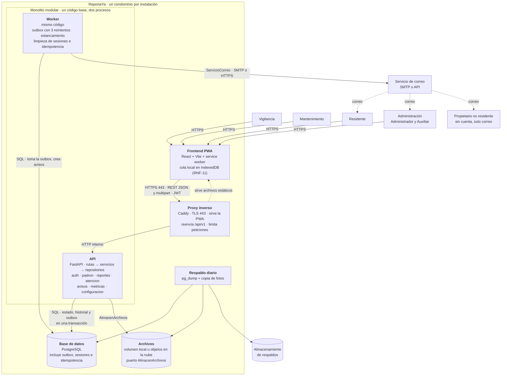

# Arquitectura de ReportaYa (versión del equipo)

**Estado:** propuesta consolidada para aprobación · **Fecha:** 2026-10-23
**Insumos comparados:**
- Diagramas de componentes de Manuel Medina (M), Alejandro Arreola (A) y Luis Guerrero (G). El diagrama de componentes de Lupus no se adjuntó; se usan sus diagramas de secuencia y sus documentos `revision_rest.md` y `decisiones_y_trazabilidad.md` como evidencia.
- ADR-001 a ADR-003 de Manuel, ADR-001 de Luis y el encabezado del ADR-001 de Alejandro (citado en sus diagramas; su archivo no se adjuntó).
- Contratos que mandan: `SRS_equipo.md` v2.0, `openapi_equipo.yaml` y `diagrama_clases_equipo.puml`.

**Importante.** El ADR de Luis se escribió sobre su SRS individual v1.2 (16 RF, 10 RNF), no sobre el SRS v2.0 del equipo. Por eso su diagrama no incluye Vigilancia, el modo sin conexión (RNF-11), el respaldo (RNF-14) ni el worker.

---

## 1. Diagrama definitivo

Fuente: `diagrama_componentes_equipo.puml` (C4 nivel 2, PlantUML). Imagen: `diagrama_componentes_equipo.png`.

**Dos reglas que el diagrama hace visibles:** (1) no hay broker ni llamada directa entre API y Worker; se comunican por la outbox en PostgreSQL; (2) la API nunca habla con el servicio de correo.

---

## 2. Comparación de los diagramas individuales

### 2.1 Consenso (los tres diagramas)

| Elemento | Resultado |
|---|---|
| Estilo: cliente-servidor con **monolito modular en capas**, sin microservicios ni broker | Se mantiene (AR-1) |
| Backend **FastAPI** con **PostgreSQL**; una sola base de datos | Se mantiene |
| API REST sobre HTTPS con JSON y `multipart` para fotos | Se mantiene |
| **Almacenamiento de archivos intercambiable** (volumen local o nube) con el patrón Adapter (RNF-08) | Se mantiene, puerto `AlmacenArchivos` |
| **Servicio de correo externo** para avisos y enlaces (RF-11, RF-14) | Se mantiene, puerto `ServicioCorreo` |
| El **propietario no residente** es una persona externa que solo recibe correo | Se mantiene |
| Los **3 reintentos** de correo viven en el servidor | Se mantiene (cada 10 min, RF-11) |
| Patrones **State, Observer y Adapter**; Repository en G | Se mantienen |
| Matriz de visibilidad (RNF-05) y contrato de errores en el backend | Se mantienen |
| Los módulos del backend por negocio | Se mantienen, con lista unificada (AR-6) |

### 2.2 Brechas (lo que incluyó solo uno o algunos)

| Elemento | Quién | Decisión |
|---|---|---|
| **Worker** como proceso aparte con el mismo código | M, A | Incluido (AR-3) |
| **Outbox transaccional** en PostgreSQL | A (explícita), M («tabla de trabajos») | Incluida (AR-4) |
| **Proxy inverso con TLS** en un contenedor | M (despliegue), G | Incluido (AR-5) |
| **Respaldo diario** y su destino | M (despliegue), G (`pg_dump`) | Incluido como contenedor propio (AR-9) |
| **Cola local de envíos pendientes** en la PWA (RNF-11) | M, A | Incluida (AR-2) |
| **Vigilancia** como rol de la PWA | M | Incluida; A la agrupa en «Usuario web» y G la omite |
| **Módulo `auth`** (sesiones, activación, recuperación) | G | Incluido; M y A no lo muestran pero el API tiene `/sessions` |
| **Sesión revocable con `sid`** (JWT más tabla de sesiones) | Lupus (secuencia) | Incluida (AR-8) |
| **Clave de idempotencia** en altas y `Terminado` | M, A, Lupus | Incluida (AR-7) |
| **Evento de dominio interno** (Observer) | M, A | Incluido |
| Puerto **Reloj** inyectado (RNF-10) | A, G | Incluido (worker y servicios) |
| Límite de peticiones en el proxy | Lupus | Incluido en el proxy |
| Módulos `gestion` y `atencion` por separado | A | Fusionados (AR-6) |
| Tecnología del frontend: Next.js | G | Descartada (AR-2) |
| Tarea periódica dentro de la API | G | Descartada (AR-3) |
| Detalle de puertos y versiones (Node 22, puertos 3000/8000/5432) | G | Se conservan solo los de despliegue útiles: 443 externo; HTTP interno |

### 2.3 Conflictos y resolución

| # | Tema | Variantes | Resolución | Razón |
|---|---|---|---|---|
| AR-2 | **Frontend** | M: «por decidir» (React+Vite o Next.js); A y Lupus: React + Vite PWA; G: Next.js en su propio contenedor Node | **PWA con React + Vite**, archivos estáticos servidos por el proxy | RNF-11 exige service worker y cola local, que una SPA estática resuelve sin servidor de render; no se necesita SSR; evita un contenedor Node más (RNF-17, R-02). Cierra la decisión C-17 que seguía abierta |
| AR-3 | **Dónde corren las tareas diferidas** | M y A: worker aparte; G: tarea periódica dentro de la API | **Worker aparte**, misma imagen y distinto comando | Con varias réplicas de la API, una tarea interna puede enviar el mismo correo dos veces (riesgo que reconoce el ADR de G); si cae el worker, la API sigue atendiendo (RNF-12) |
| AR-4 | **Cómo se encola el trabajo** | M: «tabla de trabajos» que la API llena; A: outbox escrita en la misma transacción que el cambio; G: «avisos pendientes» | **Outbox transaccional** en PostgreSQL, con bloqueo por fila al tomar trabajos | Garantiza que un cambio de estado y su aviso se guardan juntos o ninguno, y que un fallo del correo nunca impide guardar el cambio (RF-11); sin broker |
| AR-5 | **Quién sirve la PWA y termina TLS** | M: proxy (Nginx o Caddy); A: contenedor `frontend` y el navegador llama directo a la API; G: Caddy + contenedor Next.js | **Un proxy Caddy** que termina TLS, sirve los estáticos y reenvía `/api/v1` | Un solo punto de entrada HTTPS (RNF-06) sin CORS entre orígenes y sin certificado en la API; cuatro contenedores en total: proxy, API, worker y PostgreSQL |
| AR-10 | **Quién envía los correos de activación y recuperación** | M y G: la API los envía directo; A: todo sale del worker | **Todo correo sale del worker por la outbox**, incluidos activación y recuperación | Un solo camino con los mismos reintentos; la API responde `202` sin esperar al proveedor y no revela si el correo existe (RF-14-AC-3) |
| AR-8 | **Autenticación y sesión** | G: JWT Bearer; Lupus: JWT con `sid` y tabla de sesiones; A y M: sin detalle; el ADR y el diagrama de componentes que Lupus revisó decían «cookie de sesión» | **JWT Bearer con `sid`** validado contra la tabla de sesiones en cada petición | RNF-06 pide expiración por 30 min de inactividad y RF-02-AC-3 pide invalidar al desactivar a un usuario; un JWT sin estado no puede hacerlo. Coincide con `/sessions` del API |
| AR-6 | **Módulos del backend** | M: reportes, padrón, flujo de estados, métricas, notificaciones, parámetros; A: padron, reportes, gestion, atencion, avisos, metricas, configuracion; G: auth, padron, reportes, atencion, avisos, metricas | **Siete módulos:** `auth`, `padron`, `reportes`, `atencion`, `avisos`, `metricas`, `configuracion` | Cada uno corresponde a un grupo de tags del API y a un paquete del diagrama de clases (sección 4). `gestion` y `atencion` se fusionan: asignar, iniciar, terminar y cerrar son transiciones de la misma máquina de estados |
| AR-11 | **Capas** | M: API, servicios de dominio, repositorios y adaptadores; A: API, aplicación, dominio, infraestructura; G: rutas, servicios, repositorios | **Tres capas por módulo:** rutas → servicios (casos de uso y reglas de dominio) → repositorios y adaptadores. Las clases de dominio de `diagrama_clases_equipo.puml` viven en un paquete `dominio` del módulo | Las rutas solo llaman servicios; los servicios solo llaman repositorios y adaptadores. No se adopta hexagonal completa (G, ADR): solo tres puertos |
| AR-12 | **Puertos** | `AlmacenArchivos` (A), `AlmacenFotos` (G), «interfaz de almacenamiento» (M), `AlmacenamientoArchivos` (Lupus); `Correo` (G) o `ServicioCorreo` (A); `Reloj` en todos | `AlmacenArchivos`, `ServicioCorreo`, `Reloj` | El almacén guarda también el video, por eso no se llama «fotos» |
| AR-13 | **Personas del diagrama** | M: cinco; A: dos genéricas; G: tres (sin Vigilancia) | Cuatro roles más el propietario no residente | Los roles del SRS (RF-01); Vigilancia usa la PWA desde la caseta |
| AR-9 | **Respaldo** | M: nodo propio con destino externo; G: tarea `pg_dump`; A: nota sobre el volumen | **Contenedor/tarea programada** que respalda la base y el volumen de fotos a un almacenamiento externo | RNF-14; proveedor y frecuencia exacta siguen para el diseño técnico |
| AR-7 | **Idempotencia** | M, A, Lupus la incluyen; G no la menciona | Cabecera `Idempotency-Key` y tabla de claves en PostgreSQL con vigencia de 24 h | RNF-11; los endpoints marcados `x-idempotent` del API; el worker limpia las vencidas |

---

## 3. Decisión arquitectónica consolidada

### AR-1 · Estilo
Cliente-servidor con **monolito modular en capas**, una sola base de datos y **dos procesos** del mismo código (API y worker). Adaptadores solo en los tres bordes que el SRS exige intercambiar: almacenamiento de archivos, correo y reloj.

### Alternativas consideradas (coinciden los tres ADR)

| Alternativa | Por qué se descarta |
|---|---|
| Microservicios | Desproporcionados para un condominio, 100 reportes al mes y un equipo estudiantil; la matriz de visibilidad (RNF-05) y el historial de solo inserción (RNF-07) tendrían que coordinarse entre servicios; contradicen RNF-17 |
| Orientada a eventos con broker | Un componente más que operar; RF-11-AC-4 se cumple con la outbox y el worker sin broker |
| Hexagonal completa | Duplica clases en un sistema mayormente CRUD; solo tres dependencias necesitan ser intercambiables (RNF-08, RNF-10, RF-11) |

### Consecuencias
- **A favor:** costo bajo (cuatro contenedores en un servidor), reglas críticas en un solo lugar, transacciones simples (RNF-05, RNF-07, RNF-16), pruebas de los criterios con reloj fijo y almacenamiento falso, y ruta de evolución: si crece la carga o se integra WhatsApp (EX-06), el módulo `avisos` se extrae porque ya publica eventos y usa la outbox.
- **En contra:** todo se despliega junto y una falla del API afecta a todos los usuarios; la outbox en PostgreSQL es menos robusta que un broker; las fronteras entre módulos pueden erosionarse.
- **Mitigación de fronteras:** ningún módulo lee las tablas de otro; se comunican por servicios o por eventos de dominio, y se revisa en cada revisión de código.

### Cómo atiende cada RNF

| RNF | Cómo lo cumple |
|---|---|
| RNF-01 · 360 px, sin instalar | PWA responsiva en el navegador |
| RNF-02 · ≤ 3 pantallas | Interfaz; la API recibe el reporte y sus fotos en una sola petición `multipart` |
| RNF-03 · p95 ≤ 2 s con 5,000 reportes | Consultas indexadas y paginación en todas las listas |
| RNF-04 · foto de 10 MB en ≤ 15 s | Subida directa a la API; el adaptador guarda sin reprocesar |
| RNF-05 · visibilidad en el servidor | Servicio de autorización común, antes de devolver datos; un recurso oculto responde 404 |
| RNF-06 · seguridad de cuentas | Hash Argon2 o bcrypt, JWT con `sid`, 30 min de inactividad, bloqueo de 15 min tras 5 intentos, TLS en el proxy |
| RNF-07 · solo inserción | Los repositorios de historial, costos, notas y archivos no exponen actualizar ni borrar |
| RNF-08 · almacenamiento intercambiable | Puerto `AlmacenArchivos` con dos adaptadores |
| RNF-09 · accesibilidad | Frontend |
| RNF-10 · reloj fijable | Puerto `Reloj` inyectado en API y worker |
| RNF-11 · mala conectividad | Cola en IndexedDB y service worker en la PWA; `Idempotency-Key` en el servidor. **Es el requisito de mayor riesgo** (ver sección 6) |
| RNF-12 · disponibilidad 99 % | API y worker se reinician solos; si cae el worker, los correos esperan en la outbox |
| RNF-13 · retención | Política en la base y en el almacén; la garantía extiende la de fotos |
| RNF-14 · respaldos | Contenedor de respaldo diario a un almacenamiento externo |
| RNF-15 · fotos compartidas | `RegistroComparticion` y `POST /reports/{folio}/files/{fileId}/shares` |
| RNF-16 · cifras iguales | Tablero y PDF salen del mismo cálculo (`GET /metrics`) |
| RNF-17 · bajo costo | Un servidor con cuatro contenedores y sin broker |

### Patrones

| Patrón | Dónde | Requerimiento |
|---|---|---|
| Adapter | `AlmacenArchivos`, `ServicioCorreo`, `Reloj` | RNF-08, RF-11, RNF-10 |
| State | Ciclo de vida del reporte (módulo `atencion`) | RF-07, RD-04 |
| Observer | Eventos de dominio dentro de cada proceso; `avisos` los consume | RF-11, RF-17, RF-22 |
| Repository | Un repositorio por agregado | RNF-07 |
| Outbox transaccional | Correos y avisos | RF-11 |
| Idempotency Key | Altas, terminaciones y respuestas del residente | RNF-11 |

---

## 4. Correspondencia entre módulos, API y modelo de clases

| Módulo | Tags del `openapi_equipo.yaml` | Clases de dominio |
|---|---|---|
| `auth` | Autenticación | `Usuario` (credenciales), `EnlaceAcceso`; la sesión es infraestructura |
| `padron` | Unidades, Áreas comunes, Usuarios, Responsables | `Usuario` y subclases, `VinculacionUnidad`, `Ubicacion`, `Unidad`, `AreaComun`, `Propietario`, `ProveedorSinAcceso`, `Responsable` |
| `reportes` | Catálogo, Reportes, Archivos | `Reporte`, `Categoria`, `Subtipo`, `Adjunto`, `RegistroComparticion`, `VersionCorreccion` |
| `atencion` | Flujo de estados, Seguimiento, Costos y garantía | `CicloAtencion`, `ConfirmacionResidente`, `Detencion`, `CambioEstado`, `Reclasificacion`, `NotaAvance`, `Costo`, `IndicacionPersistencia`, `EntradaHistorial` |
| `avisos` | Avisos | `Aviso`, `AvisoSistema`, `EnvioCorreo` |
| `metricas` | Tablero | Derivados (sin clases propias) |
| `configuracion` | Delegaciones, Parámetros | `Delegacion`, `Parametro`, `CambioParametro` |

---

## 5. Despliegue

Un servidor en la nube con Docker Compose y **cuatro contenedores**: `proxy` (Caddy), `api`, `worker` (misma imagen que `api`, otro comando) y `db` (PostgreSQL con volumen persistente). El volumen de archivos se monta en `api` o se sustituye por almacenamiento de objetos por configuración. La tarea de respaldo corre en el servidor y sube a un almacenamiento externo. API y worker se reinician automáticamente. Solo el puerto 443 se expone.

---

## 6. Riesgos y pendientes

1. **RNF-11 es el requisito más costoso.** Prototipar en las primeras semanas la cola offline con fotos y la idempotencia del servidor. Si no es viable en 12 semanas, se difiere explícitamente en la sección 5 del SRS sin bajar su nivel.
2. **Generación del PDF del tablero** (RF-23): no hay librería elegida; debe vivir en el módulo `metricas` y usar los mismos datos que el JSON.
3. **Proveedor de correo, de nube y de respaldos:** siguen abiertos (diseño técnico).
4. **Actualizar los diagramas individuales** que quedan desalineados con esta decisión:
   - M: el diagrama muestra que la API envía correo directo y el proxy no aparece en el diagrama de contenedores.
   - A: el navegador llama directo a la API y existe un contenedor `frontend`; falta el proxy y el módulo `auth`.
   - G: Next.js, tarea periódica en la API, ausencia de Vigilancia, worker, PWA offline y respaldo.
   - Lupus: sus secuencias usan rutas viejas del API (`/sesiones`, `/transiciones`) y, según su propia revisión, su ADR y su diagrama de componentes decían «cookie de sesión».
5. **Replicas de la API:** con una sola réplica no hay problema; si se agregan, el worker sigue siendo uno y la outbox se toma con bloqueo por fila.
6. **Criterio de revisión:** se reconsidera si el sistema atiende a más de un condominio (EX-07), si la carga supera lo previsto en RNF-03 o si se aprueba una integración que requiera procesamiento asíncrono independiente (EX-06).
